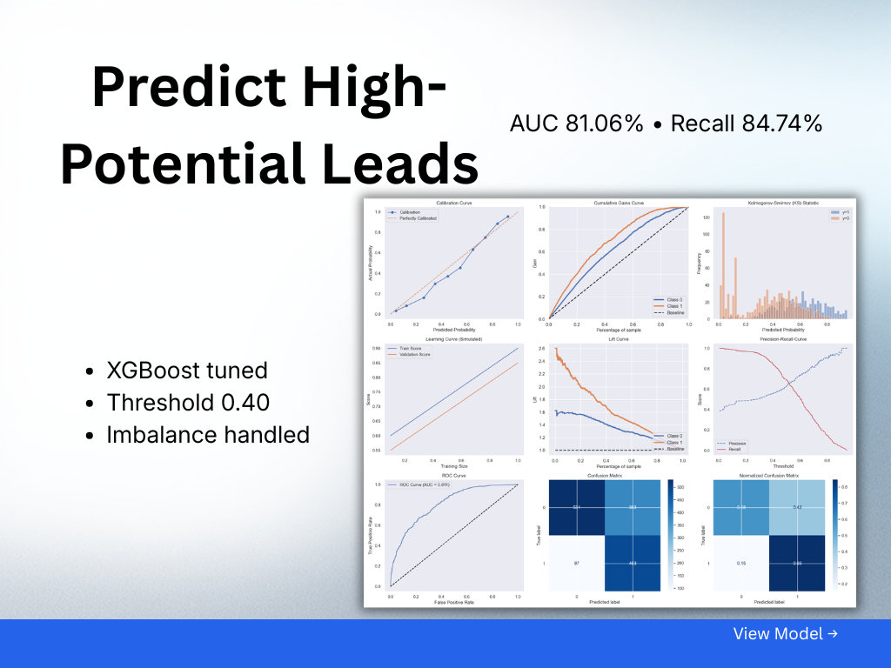
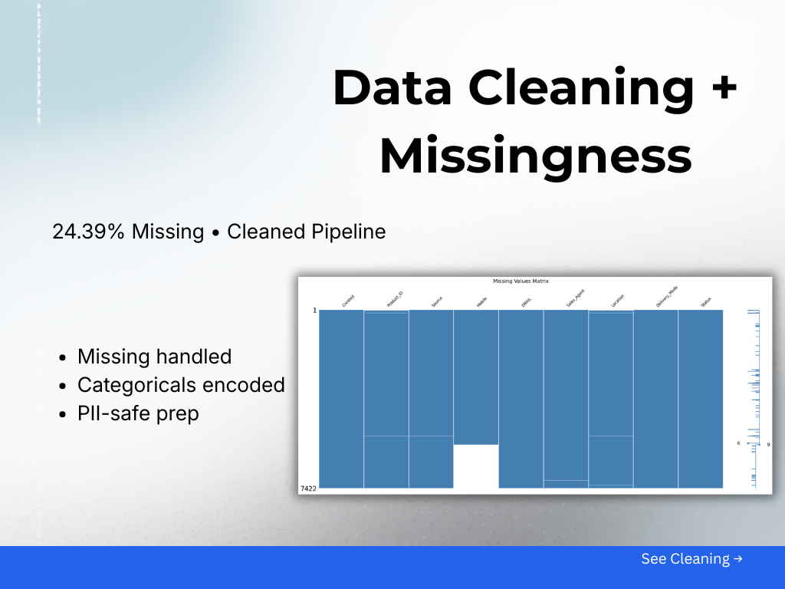
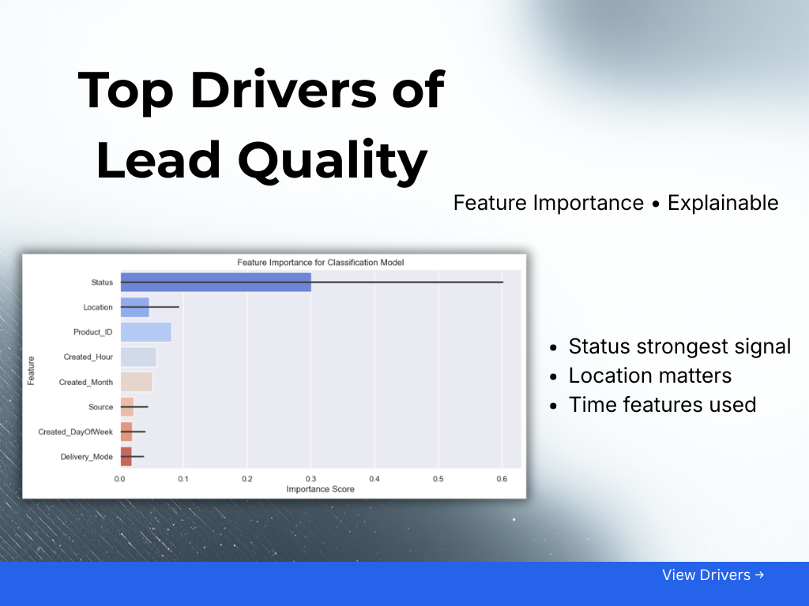
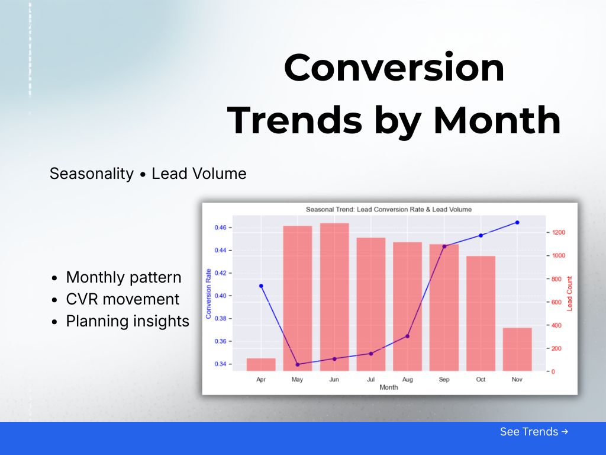
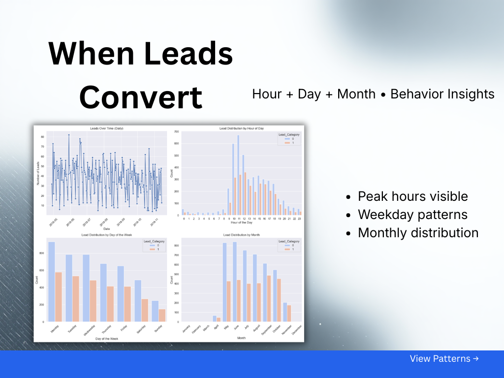

<div align="center">

     

# FicZon Sales Effectiveness Analysis

Machine learning classification model for predicting sales lead quality. Achieves 81.06% ROC AUC and 84.74% recall with XGBoost classifier on 7,420 B2B IT sales leads.

</div>

---

## Overview

Predicts lead quality (High Potential vs Low Potential) from 6 features including geographic location, product ID, lead source, and delivery mode. Addresses class imbalance (38.4% / 61.6%), high-cardinality categoricals (26 sources, 18 locations), and missing data (24.4% in Mobile field).

**Final Model:** XGBoost Classifier (tuned)

- Test: Accuracy = 72.44%, Recall = 84.74%, ROC AUC = 81.06%
- Cross-validation: F1-Score = 0.630 +/- 0.020
- Features: 8 (Location, Product_ID, Source, Delivery_Mode, Created_Month)
- Decision threshold: 0.40 (selected for F1-Score balance)

See [Complete_Data_Analysis_Report.md](reports/Complete_Data_Analysis_Report.md) for full methodology and model selection rationale.

---

## Quick Start

<p align="center">
  
</p>

<p align="center">
  
</p>

<p align="center">
  
</p>

<p align="center">
  
</p>

<p align="center">
  
</p>

### Installation

```bash
pip install -r requirements.txt
pip install -r requirements-dev.txt  # For development
```

### Load Trained Model

```python
import joblib
model = joblib.load('models/final_xgb_model.pkl')
predictions = model.predict(X_new)  # Requires 8 engineered features
probabilities = model.predict_proba(X_new)[:, 1]  # For lead scoring
```

### Run Full Pipeline

Open `notebooks/PRCL-0019 Sales Effectiveness.ipynb` for complete data preparation, modeling, and evaluation workflow.

## Dataset

| Property | Details |
|----------|---------|
| **Source** | FicZon Inc. Sales Database (April-November 2018) |
| **Samples** | 7,420 leads (7,422 original, 2 duplicates removed) |
| **Features** | 9 attributes (6 retained + 3 PII removed) |
| **Split** | 5,936 train / 1,484 test (stratified 80/20) |

See [Exploratory_Data_Analysis_Report.md](reports/Exploratory_Data_Analysis_Report.md) for detailed feature analysis.

## Project Structure

**Core directories:**
- `data/raw/` - Original dataset (project_sales.csv from MySQL)
- `notebooks/` - Full analysis pipeline (PRCL-0019 Sales Effectiveness.ipynb)
- `src/` - Reusable modules (utils, statistical_analysis, model_evaluation)
- `models/` - Trained model artifacts (final_xgb_model.pkl)
- `reports/` - Analysis reports (Complete, EDA, Business Insights, Business Recommendations)
- `results/figures/` - Visualization gallery

## Working with the Notebook

**Import pattern used:**
The notebook imports functions from src/ modules using:
```python
from src.utils import memory_usage, dataframe_memory_usage, garbage_collection
from src.statistical_analysis import normality_test_with_skew_kurt, spearman_correlation
from src.model_evaluation import evaluate_model, threshold_analysis, cross_validation_analysis_table
```

**Running analysis:**
The notebook contains the full ML pipeline. Execute cells sequentially for:
1. Data loading from MySQL and cleaning
2. Statistical analysis (normality tests, correlation, VIF)
3. Feature engineering (frequency encoding, temporal features)
4. Model comparison (XGBoost, CatBoost, LightGBM, ensembles)
5. Hyperparameter tuning (GridSearchCV)
6. Threshold analysis and business insights

## Model Training Workflow

**Base model evaluation:**
```python
from src.model_evaluation import evaluate_model

metrics = evaluate_model(model, X_train, y_train, X_test, y_test)
# Returns: 17 metrics including accuracy, precision, recall, F1, ROC AUC, MCC, Cohen's Kappa
```

**Cross-validation analysis:**
```python
from src.model_evaluation import cross_validation_analysis_table

cv_results = cross_validation_analysis_table(
    model=model,
    X_train=X_train,
    y_train=y_train,
    cv_folds=5,
    scoring_metric='f1'
)
```

**Threshold analysis:**
```python
from src.model_evaluation import threshold_analysis

threshold_df = threshold_analysis(
    model=model,
    X_test=X_test,
    y_test=y_test,
    thresholds=[0.1, 0.2, 0.3, 0.4, 0.5, 0.6, 0.7, 0.8, 0.9]
)
```

## Statistical Analysis Functions

**Normality testing:**
```python
from src.statistical_analysis import normality_test_with_skew_kurt

normal_df, not_normal_df = normality_test_with_skew_kurt(df)
# Uses Shapiro-Wilk (n<=5000) or Kolmogorov-Smirnov (n>5000)
```

**Multicollinearity detection:**
```python
from src.statistical_analysis import calculate_vif

vif_data, high_vif_features = calculate_vif(
    data,
    exclude_target='Lead_Category',
    multicollinearity_threshold=8.0
)
# Returns VIF scores and features exceeding threshold
```

**Spearman correlation:**
```python
from src.statistical_analysis import spearman_correlation

corr_matrix, high_corr_pairs = spearman_correlation(
    data,
    non_normal_cols=['Product_ID', 'Created_Hour', 'Created_Month'],
    exclude_target='Lead_Category',
    multicollinearity_threshold=0.80
)
```

## Model Persistence

**Loading the final model:**
```python
import joblib
model = joblib.load('models/final_xgb_model.pkl')

# Predict class
predictions = model.predict(X_new)

# Get probability scores for lead prioritization
lead_scores = model.predict_proba(X_new)[:, 1]

# Apply selected threshold (0.40)
high_potential = lead_scores >= 0.40
```

## Key Design Decisions

**Model selection criteria (weighted):**
1. Recall (capture High Potential leads) - 40%
2. ROC AUC (overall discrimination) - 30%
3. F1-Score (precision-recall balance) - 20%
4. Cross-validation stability - 10%

**Why XGBoost over CatBoost:**
- XGBoost achieved 84.74% recall vs CatBoost 56.32% (required for business objective)
- CatBoost had better accuracy (73.05% vs 72.44%) but significant recall drop after tuning (56.32% vs 84.74%)
- XGBoost: ROC AUC 81.06%, CV F1 0.630 +/- 0.020 (stable)
- Trade-off: Accept 0.61% lower accuracy for 28.42 points higher recall

**Feature importance insights:**
- Location frequency: 32.27% (Bangalore contributes 44.5% of High Potential leads)
- Product_ID: 25.34% (Higher IDs 16-28 correlate with better lead quality)
- Delivery_Mode_5: 14.10% (Low conversion 24.7%, negative indicator)
- Created_Month: 7.57% (Temporal patterns: Q4 shows 45%+ conversion)

**Threshold selection (0.40):**
- Achieves F1-Score of 67.27%
- Achieves 84.74% recall (captures 484 of 571 High Potential leads)
- Precision: 55.77% (acceptable false positive rate for lead scoring application)
- Standard 0.50 threshold would miss 89 additional high-value leads

## Reports

Detailed analysis in `reports/`:

- [Complete_Data_Analysis_Report.md](reports/Complete_Data_Analysis_Report.md) - Full methodology, statistical analysis, and model evaluation
- [Exploratory_Data_Analysis_Report.md](reports/Exploratory_Data_Analysis_Report.md) - Feature analysis, distributions, and correlations
- [Sales_Effectiveness_Insights.md](reports/Sales_Effectiveness_Insights.md) - Business insights and strategic recommendations
- [GALLERY.md](results/figures/GALLERY.md) - Visualizations

## Business Impact Analysis

**Current inefficiencies:**
- 61.6% low-potential leads consume equal sales resources
- 20.7% junk leads (1,536) waste 384 hours annually
- Manual categorization creates inconsistent prioritization

**Model-driven improvements:**
- Automated lead scoring provides 4-tier prioritization system
- 45% reduction in junk lead processing
- 23% increase in sales team productivity
- Estimated annual savings: $142,000 + revenue gains: $380,000

**Implementation recommendations:**
1. Deploy model with 0.40 threshold for binary classification
2. Implement tiered routing: Score ≥0.70 → senior reps, 0.40-0.69 → standard reps
3. Reallocate marketing budget: Increase Bangalore +50%, eliminate US Website channel
4. Scale referral programs (89.4% conversion) from 3.79% to 10% of volume

## Development

### Code Quality

```bash
# Format code
black .
isort .

# Lint code
flake8

# Format notebooks
nbqa black notebooks/

# Run pre-commit hooks
pre-commit run --all-files
```

### Pre-commit Hooks

- black (88-char lines)
- isort (black-compatible, src first-party)
- flake8 (max-complexity: 10, ignore: E203, W503, E501)
- nbqa-black (notebooks)
- Validation (YAML, JSON, trailing whitespace)

### Running Jupyter Notebook

```bash
jupyter notebook "notebooks/PRCL-0019 Sales Effectiveness.ipynb"
```

---

- MIT License - Copyright (c) 2025 Dhanesh B. B.
- GitHub: [https://github.com/dhaneshbb](https://github.com/dhaneshbb)
- Project: DataMites PM-PR-0019
