# Visualizations Gallery

Analysis visualizations.

| | |
|:---:|:---:|
| **Figure 0** | **Figure 1** |
| 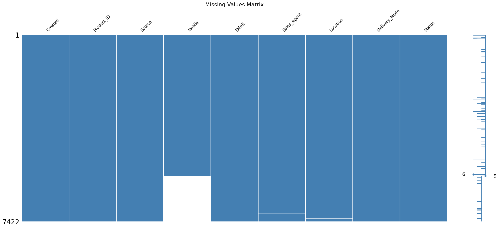 | 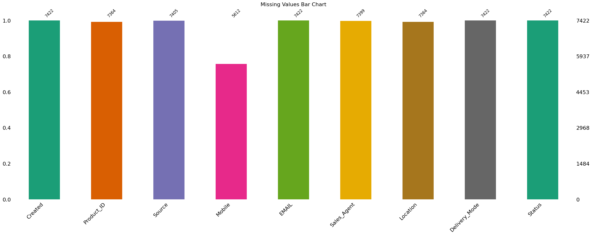 |
| **Figure 2** | **Figure 3** |
| 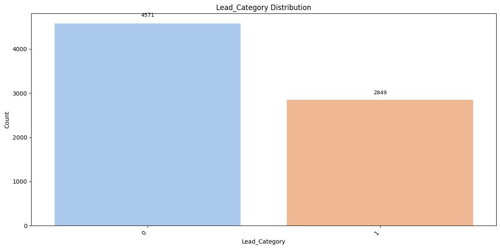 | 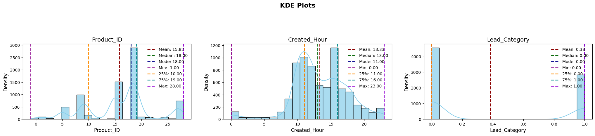 |
| **Figure 4** | **Figure 5** |
| 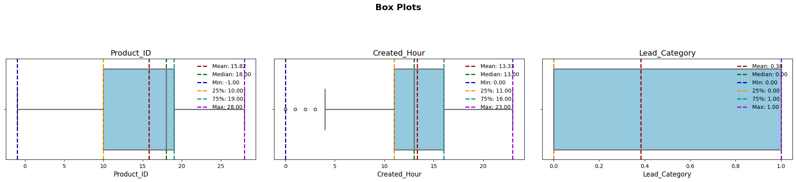 | 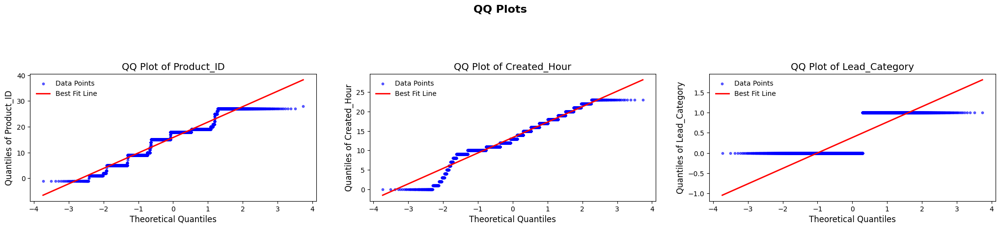 |
| **Figure 6** | **Figure 7** |
| 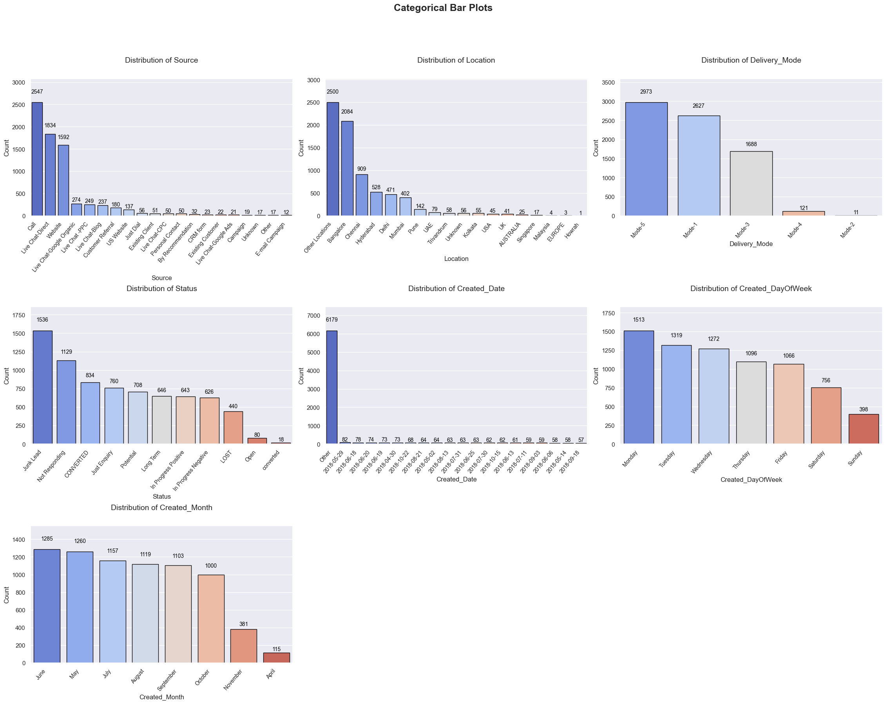 | 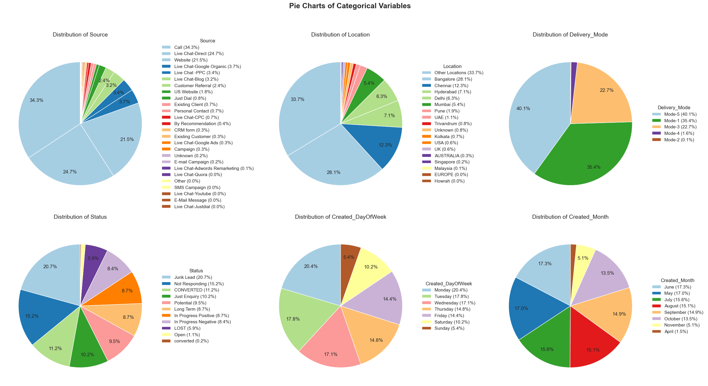 |
| **Figure 8** | **Figure 9** |
| 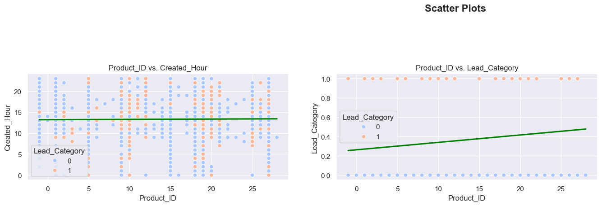 | 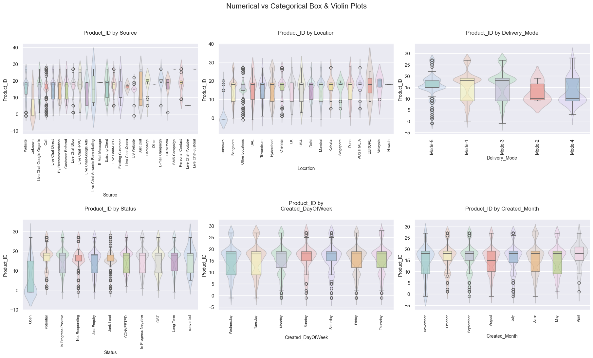 |
| **Figure 10** | **Figure 11** |
| 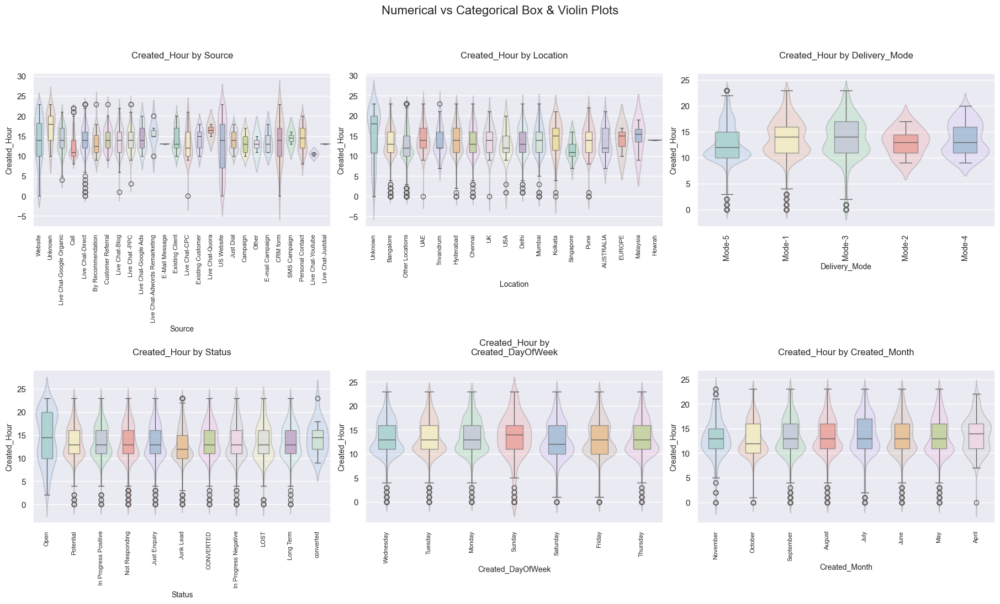 | 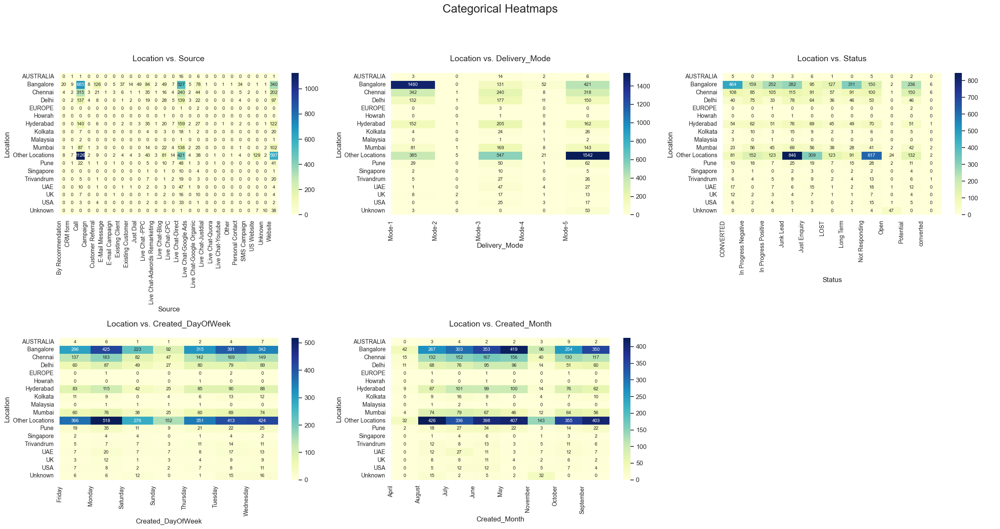 |
| **Figure 12** | **Figure 13** |
| 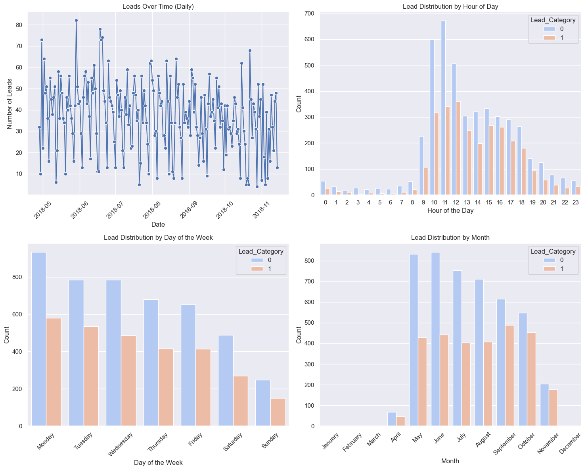 | 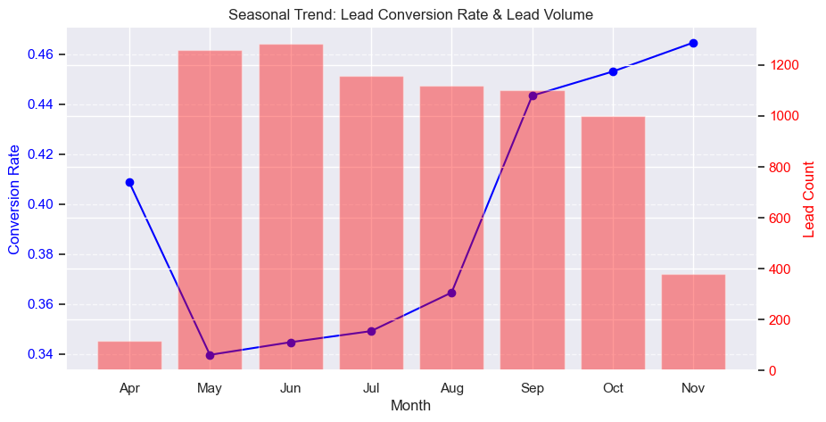 |
| **Figure 14** | **Figure 15** |
| 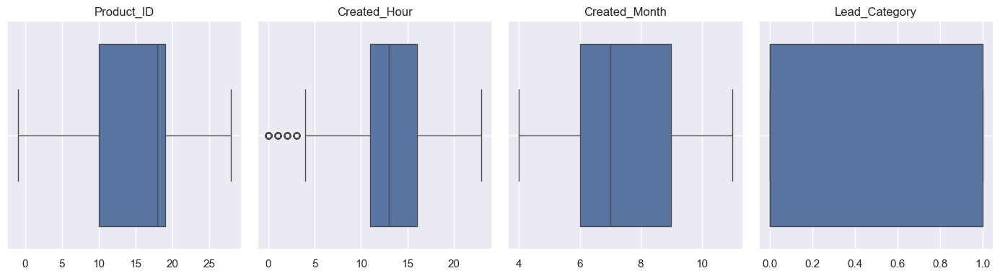 | 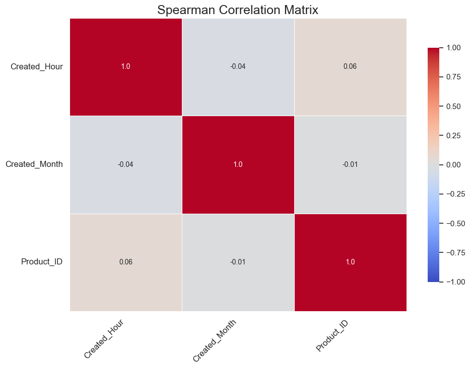 |
| **Figure 16** | **Figure 17** |
| 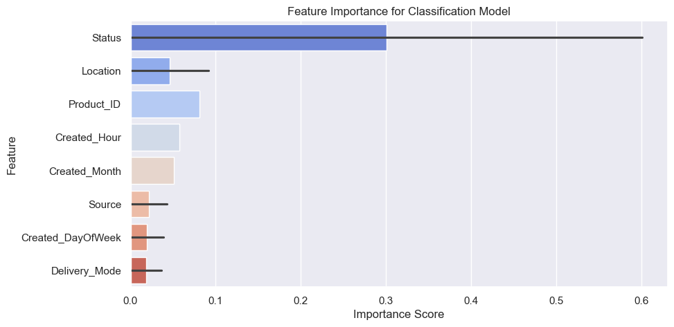 | 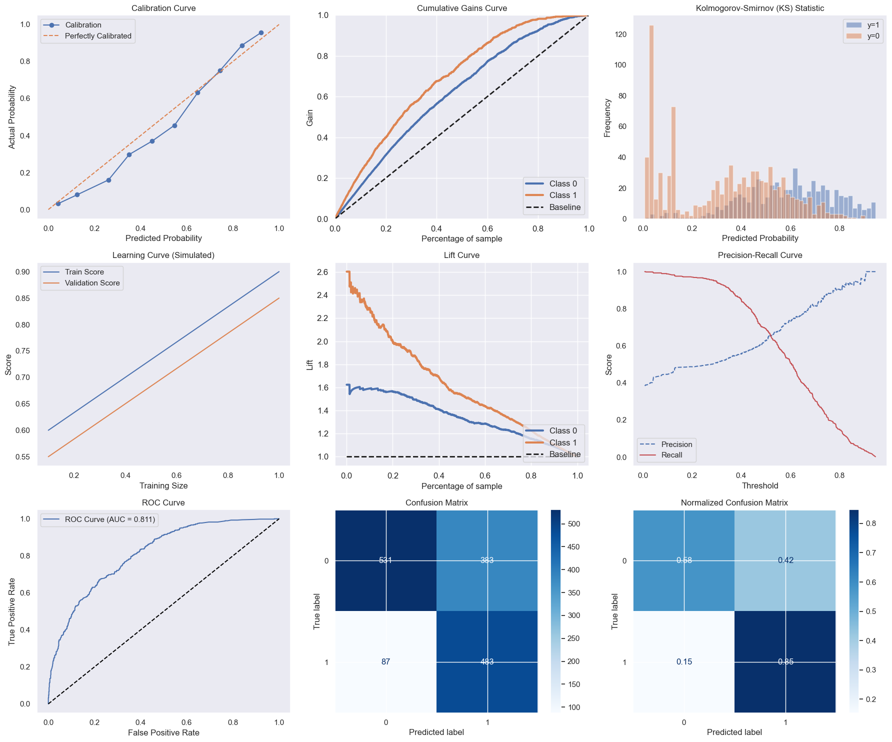 |

---

**Source:** `notebooks/PRCL-0019 Sales Effectiveness.ipynb`
